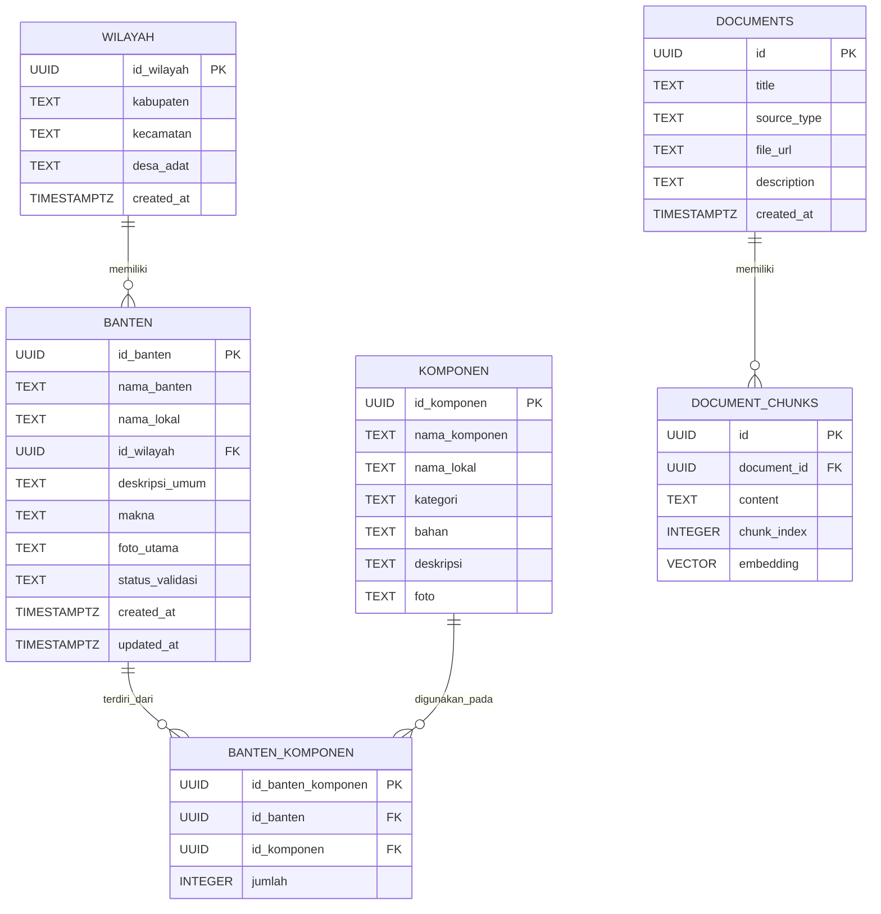

# Database Schema — BantenPedia

## 1. Entity Relationship Diagram

## 2. Tabel `wilayah`

Menyimpan informasi wilayah geografis dan adat yang terkait dengan data banten.

| Kolom        | Tipe data   | Keterangan           |
| ------------ | ----------- | -------------------- |
| `id_wilayah` | UUID        | Primary key          |
| `kabupaten`  | TEXT        | Nama kabupaten       |
| `kecamatan`  | TEXT        | Nama kecamatan       |
| `desa_adat`  | TEXT        | Nama desa adat       |
| `created_at` | TIMESTAMPTZ | Waktu pembuatan data |

## 3. Tabel `banten`

Menyimpan informasi utama mengenai banten.

| Kolom             | Tipe data   | Keterangan                          |
| ----------------- | ----------- | ----------------------------------- |
| `id_banten`       | UUID        | Primary key                         |
| `nama_banten`     | TEXT        | Nama banten                         |
| `nama_lokal`      | TEXT        | Nama lokal atau alternatif          |
| `id_wilayah`      | UUID        | Foreign key ke `wilayah.id_wilayah` |
| `deskripsi_umum`  | TEXT        | Deskripsi umum banten               |
| `makna`           | TEXT        | Makna banten                        |
| `foto_utama`      | TEXT        | Referensi foto utama                |
| `status_validasi` | TEXT        | Status validasi data                |
| `created_at`      | TIMESTAMPTZ | Waktu pembuatan data                |
| `updated_at`      | TIMESTAMPTZ | Waktu pembaruan data                |

## 4. Tabel `komponen`

Menyimpan informasi komponen yang digunakan dalam banten.

| Kolom           | Tipe data | Keterangan              |
| --------------- | --------- | ----------------------- |
| `id_komponen`   | UUID      | Primary key             |
| `nama_komponen` | TEXT      | Nama komponen           |
| `nama_lokal`    | TEXT      | Nama lokal komponen     |
| `kategori`      | TEXT      | Kategori komponen       |
| `bahan`         | TEXT      | Informasi bahan         |
| `deskripsi`     | TEXT      | Deskripsi komponen      |
| `foto`          | TEXT      | Referensi foto komponen |

## 5. Tabel `banten_komponen`

Menghubungkan banten dengan komponen yang menyusunnya. Tabel ini merepresentasikan relasi many-to-many antara `banten` dan `komponen`.

| Kolom                | Tipe data | Keterangan                            |
| -------------------- | --------- | ------------------------------------- |
| `id_banten_komponen` | UUID      | Primary key                           |
| `id_banten`          | UUID      | Foreign key ke `banten.id_banten`     |
| `id_komponen`        | UUID      | Foreign key ke `komponen.id_komponen` |
| `jumlah`             | INTEGER   | Jumlah komponen jika dicatat          |

## 6. Tabel `documents`

Menyimpan metadata dokumen sumber untuk sistem Retrieval-Augmented Generation (RAG).

| Kolom         | Tipe data   | Keterangan              |
| ------------- | ----------- | ----------------------- |
| `id`          | UUID        | Primary key             |
| `title`       | TEXT        | Judul dokumen           |
| `source_type` | TEXT        | Jenis sumber dokumen    |
| `file_url`    | TEXT        | Referensi atau URL file |
| `description` | TEXT        | Deskripsi dokumen       |
| `created_at`  | TIMESTAMPTZ | Waktu pembuatan data    |

## 7. Tabel `document_chunks`

Menyimpan potongan teks dokumen beserta embedding untuk pencarian semantik.

| Kolom         | Tipe data   | Keterangan                      |
| ------------- | ----------- | ------------------------------- |
| `id`          | UUID        | Primary key                     |
| `document_id` | UUID        | Foreign key ke `documents.id`   |
| `content`     | TEXT        | Isi teks potongan dokumen       |
| `chunk_index` | INTEGER     | Urutan potongan dalam dokumen   |
| `embedding`   | VECTOR(768) | Vektor embedding berdimensi 768 |

## 8. Fungsi `match_document_chunks`

Fungsi PostgreSQL untuk mengambil potongan dokumen yang paling relevan berdasarkan kemiripan embedding.

**Parameter:**

- `query_embedding`: `VECTOR(768)` — embedding dari pertanyaan.
- `match_count`: `INT`, default `5` — jumlah maksimum hasil.

**Kolom hasil:**

| Kolom         | Tipe data | Keterangan                                 |
| ------------- | --------- | ------------------------------------------ |
| `id`          | UUID      | ID chunk                                   |
| `document_id` | UUID      | ID dokumen sumber                          |
| `content`     | TEXT      | Isi chunk                                  |
| `chunk_index` | INTEGER   | Urutan chunk                               |
| `similarity`  | FLOAT     | Skor kemiripan berdasarkan cosine distance |

Fungsi mengurutkan chunk berdasarkan jarak cosine terkecil menggunakan operator pgvector `<=>`, kemudian mengembalikan hasil sesuai batas `match_count`.

## 9. Relasi Antarentitas

- `wilayah` → `banten`: satu wilayah dapat memiliki banyak data banten.
- `banten` ↔ `komponen`: relasi many-to-many melalui `banten_komponen`.
- `documents` → `document_chunks`: satu dokumen dapat memiliki banyak chunk.

## 10. Alur Data

### Data Terstruktur

`wilayah` → `banten` → `banten_komponen` ← `komponen`

Digunakan untuk menyimpan dan mengambil informasi banten serta komponen penyusunnya.

### Data RAG

`documents` → `document_chunks` → embedding → pencarian semantik melalui `match_document_chunks`

Digunakan untuk menemukan bagian dokumen yang relevan dengan pertanyaan pengguna.
